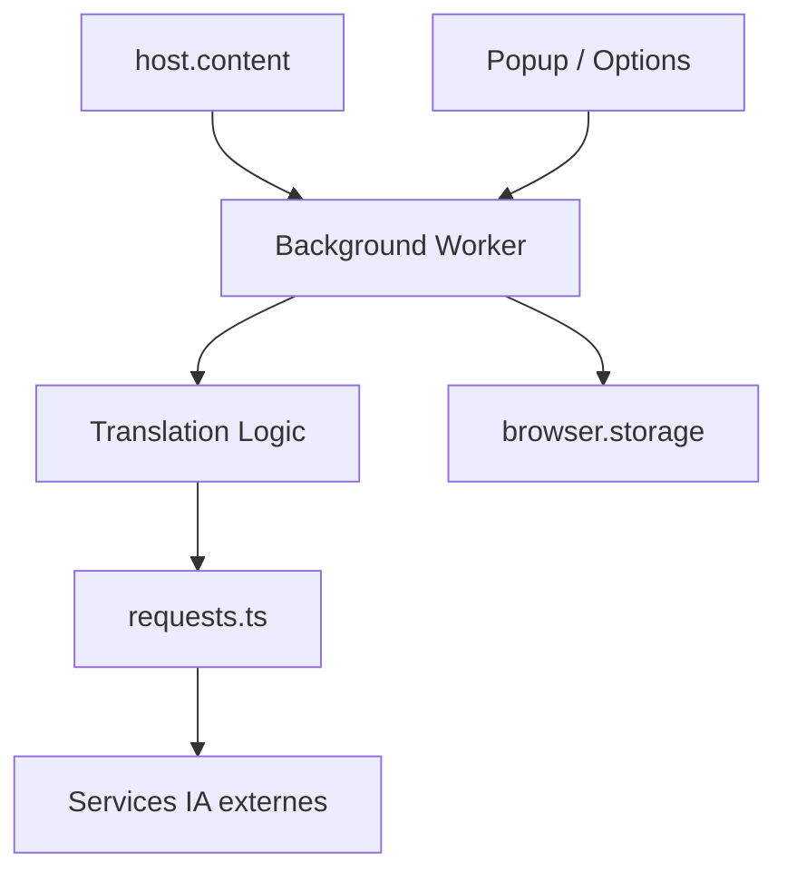

# mengxi-ream/read-frog

> Extension de navigateur d'apprentissage des langues par IA : traduction de pages, de sélections et de sous-titres.

## Le problème
Lire et regarder des contenus en langue étrangère oblige à copier-coller dans un traducteur et à perdre le contexte.

## Ce que ça fait vraiment
Traduit des pages (mode bilingue ou traduction seule), des sélections et des sous-titres sur YouTube, X et Netflix, avec contexte de page. Actions IA personnalisées, synthèse vocale, flashcards à répétition espacée, regroupement des requêtes. Plus de 20 fournisseurs via Vercel AI SDK, plus Google Translate, Microsoft Translate et DeepLX.

## Comment c'est branché

## Essayer
Aucune commande d'installation dans le README : extension à installer depuis les boutiques Chrome, Edge ou Firefox. Le diagramme d'architecture cite `pnpm dev`, `pnpm zip` et `pnpm zip:firefox`, hors README fourni.

## Coût et pièges
Les fournisseurs d'IA demandent tes propres clés d'API. Certaines fonctions (transcription audio YouTube) sont réservées aux offres Pro et Ultra. Double licence GPLv3 et commerciale.

## Ce que ce n'est pas
Pas un outil hors ligne : le contenu des pages part chez le fournisseur choisi.

## Alternatives
Immersive Translate, dont c'est une alternative libre (cité dans le README).

## Pour toi
À ignorer pour ton métier : outil d'apprentissage des langues, sans rapport direct avec data, IA ou MLOps, et licence à clauses commerciales.

