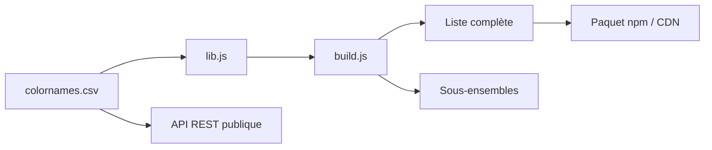

# meodai/color-names

> Curated list of over 31,900 color names with hex values, in several formats and through an API.

## The problem
Matching a readable name to a color requires a reliable list, without duplicates or offensive names.

## What it actually does
A central CSV file feeds a build script that produces JSON, CSV, YAML, XML, SCSS and others, in three sets: full, "best of" and short names. npm package `color-name-list` and a public REST API (api.color.pizza). Names are selected by humans, with a policy against AI-generated names.

## How it is wired


## Trying it
```bash
npm install color-name-list
npm install && npm run build
```
```javascript
import { colornames } from 'color-name-list';
const white = colornames.find((c) => c.hex === '#ffffff');
```

## Cost and gotchas
Free; the API has no limit, but excessive commercial traffic may lead to a sponsorship request. Full package: 1.22 MB, so use the API or a subset for the browser.

## What it is not
Not a color picker tool: the API only returns the closest name. The code of the API and of the search tools is not in this repo.

## Alternatives
None cited in the README (merged sources: xkcd, ntc.js, Wikipedia).

## For you
Useful for labeling colors in dataviz or in a dataset; permissive MIT license: adopt.
