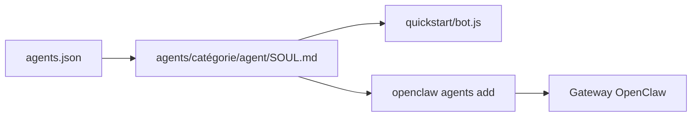

# mergisi/awesome-openclaw-agents

> List of 197 AI agent templates as `SOUL.md` files for the OpenClaw ecosystem.

## The problem
Writing from scratch the personality and rules prompt for each agent takes a long time.

## What it actually does
Offers ready-to-copy `SOUL.md` files, sorted into about twenty categories (productivity, development, DevOps, finance, health, law...). A small `quickstart` project (`bot.js`) runs them. A paid offer, CrewClaw, generates a deployment package. The agents are also exported as `agents.json`.

## How it is wired
Simplified diagram based on the fiche, no diagram provided.



## Trying it
```bash
git clone https://github.com/mergisi/awesome-openclaw-agents.git
cd awesome-openclaw-agents/quickstart
npm install && cp ../agents/productivity/orion/SOUL.md ./SOUL.md
node bot.js
```

## Cost and gotchas
The templates are free but the agent uses a model provider at your expense. The README pushes toward CrewClaw (paid) and a newsletter; the README provided is truncated.

## What it is not
It is not proven code: these are prompt files, with no guarantee of results. The README's "production-ready" claim is not demonstrated.

## Alternatives
No alternative named in the README provided.

## For you
Ignore: generic prompts with no evaluation, and a subject far from your data / MLOps work.
