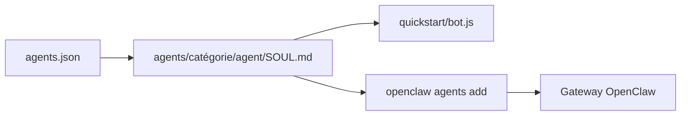

# mergisi/awesome-openclaw-agents

> Liste de 197 modèles d'agents IA sous forme de fichiers `SOUL.md` pour l'écosystème OpenClaw.

## Le problème
Écrire de zéro le prompt de personnalité et de règles de chaque agent est long.

## Ce que ça fait vraiment
Propose des fichiers `SOUL.md` prêts à copier, classés en une vingtaine de catégories (productivité, développement, DevOps, finance, santé, droit...). Un petit projet `quickstart` (`bot.js`) les fait tourner. Une offre payante, CrewClaw, génère un paquet de déploiement. Les agents sont aussi exportés en `agents.json`.

## Comment c'est branché
Schéma simplifié d'après la fiche, sans diagramme fourni.



## Essayer
```bash
git clone https://github.com/mergisi/awesome-openclaw-agents.git
cd awesome-openclaw-agents/quickstart
npm install && cp ../agents/productivity/orion/SOUL.md ./SOUL.md
node bot.js
```

## Coût et pièges
Les modèles sont gratuits mais l'agent consomme un fournisseur de modèle à ta charge. Le README pousse vers CrewClaw (payant) et une newsletter ; le README fourni est tronqué.

## Ce que ce n'est pas
Ce n'est pas du code éprouvé : ce sont des fichiers de prompts, sans garantie de résultat. Le terme « production-ready » du README n'est pas démontré.

## Alternatives
Aucune alternative nommée dans le README fourni.

## Pour toi
À ignorer : des prompts génériques sans évaluation, et un sujet éloigné de ton travail data / MLOps.

