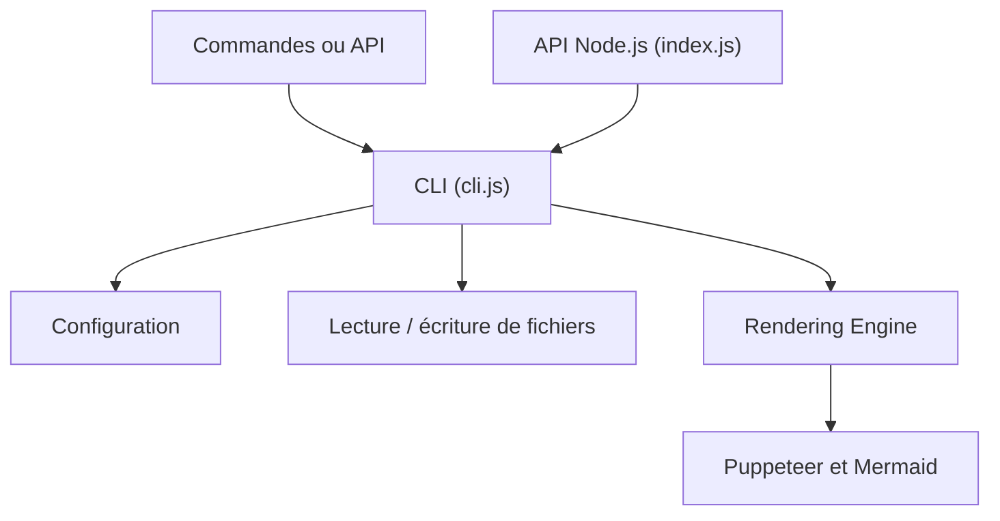

# mermaid-js/mermaid-cli

> Command line that turns Mermaid files or Markdown into SVG, PNG or PDF images.

## The problem
Mermaid diagrams only display in compatible viewers; images are needed for documents or pipelines.

## What it actually does
`mmdc` reads a Mermaid definition, renders it via Puppeteer and Mermaid, and writes SVG, PNG or PDF. It accepts a theme, transparent background, custom CSS, icon packs, output size and stdin input. On a Markdown file, it replaces each `mermaid` block with an image. A Node.js API and Docker/Podman images exist.

## How it is wired


## Trying it
```bash
npm install -g @mermaid-js/mermaid-cli
mmdc -i input.mmd -o output.svg
mmdc -i input.mmd -o output.png -t dark -b transparent
mmdc -i readme.template.md -o readme.md
```

## Cost and gotchas
Free. It launches a headless browser: on Linux, the README flags sandbox and Docker permission issues, and global installation sometimes causes problems (prefer npx or local installation). The Node.js API is not covered by semver.

## What it is not
Not a diagram editor. Installation via brew is no longer supported.

## Alternatives
No alternative cited in the README.

## For you
Adopt it to generate diagrams from text in your repos, docs and CI: simple and with no dependency on a service.
