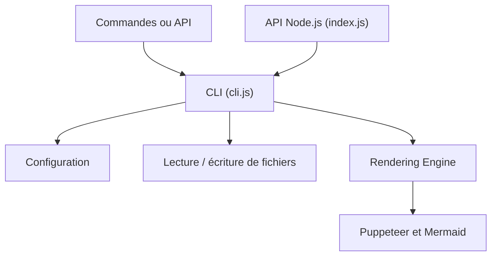

# mermaid-js/mermaid-cli

> Ligne de commande qui transforme des fichiers Mermaid ou du Markdown en images SVG, PNG ou PDF.

## Le problème
Les diagrammes Mermaid ne s'affichent que dans des visionneuses compatibles ; il faut des images pour des documents ou des pipelines.

## Ce que ça fait vraiment
`mmdc` lit une définition Mermaid, la rend via Puppeteer et Mermaid, et écrit SVG, PNG ou PDF. Il accepte thème, fond transparent, CSS personnalisé, packs d'icônes, taille de sortie et entrée par stdin. Sur un fichier Markdown, il remplace chaque bloc `mermaid` par une image. Une API Node.js et des images Docker/Podman existent.

## Comment c'est branché


## Essayer
```bash
npm install -g @mermaid-js/mermaid-cli
mmdc -i input.mmd -o output.svg
mmdc -i input.mmd -o output.png -t dark -b transparent
mmdc -i readme.template.md -o readme.md
```

## Coût et pièges
Gratuit. Il lance un navigateur sans interface : sur Linux, le README signale des soucis de sandbox et de permissions Docker, et l'installation globale pose parfois problème (préfère npx ou l'installation locale). L'API Node.js n'est pas couverte par semver.

## Ce que ce n'est pas
Pas un éditeur de diagrammes. L'installation par brew n'est plus supportée.

## Alternatives
Aucune alternative citée dans le README.

## Pour toi
À adopter pour générer des schémas depuis du texte dans tes dépôts, docs et CI : simple et sans dépendance à un service.

