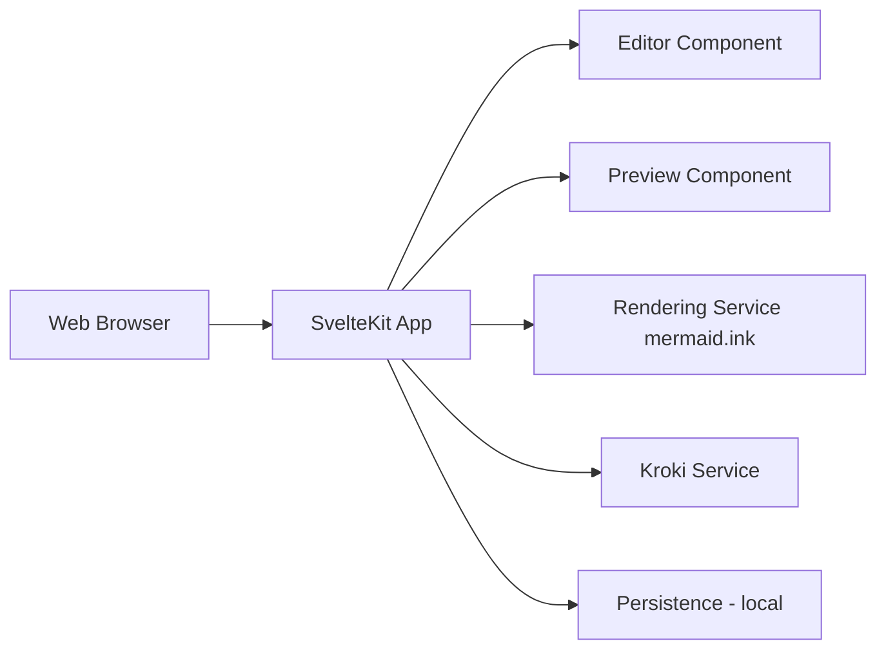

# mermaid-js/mermaid-live-editor

> Web editor to write, preview and share Mermaid diagrams, for developers and writers.

## The problem
Writing Mermaid blind is painful: you need visual feedback and a way to share.

## What it actually does
SvelteKit application: editor on the left, real-time preview, SVG export, shareable view or edit links. PNG/SVG rendering goes through a service (mermaid.ink by default), Kroki optionally, Plausible analytics disabled by default. The published Docker image uses the default variables.

## How it is wired


## Trying it
```bash
docker run --platform linux/amd64 --publish 8000:8080 ghcr.io/mermaid-js/mermaid-live-editor
pnpm install
pnpm dev -- --open
```

## Cost and gotchas
Free. PNG/SVG links depend on mermaid.ink; to change this service or Kroki, you must rebuild the image (build variables).

## What it is not
Not a real-time collaborative diagramming tool.

## Alternatives
No alternative named in the README (Mermaid Chart is cited as a promotional option).

## For you
Adopt for documenting MLOps pipelines and architectures: simple, self-hostable.
