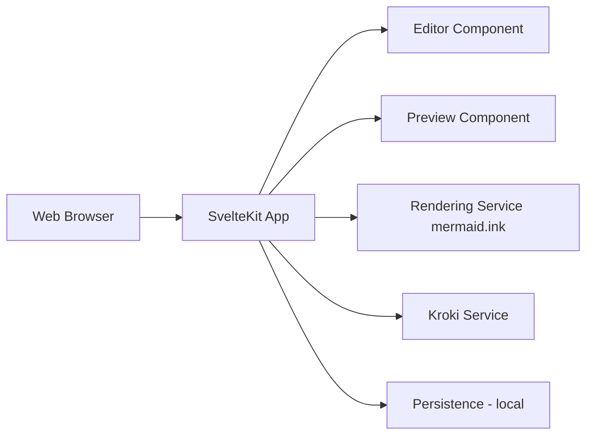

# mermaid-js/mermaid-live-editor

> Éditeur web pour écrire, prévisualiser et partager des diagrammes Mermaid, pour développeurs et rédacteurs.

## Le problème
Écrire du Mermaid à l'aveugle est pénible : il faut un retour visuel et un moyen de partager.

## Ce que ça fait vraiment
Application SvelteKit : éditeur à gauche, aperçu en temps réel, export SVG, liens de visualisation ou d'édition partageables. Le rendu PNG/SVG passe par un service (mermaid.ink par défaut), Kroki en option, analytics Plausible désactivées par défaut. L'image Docker publiée utilise les variables par défaut.

## Comment c'est branché


## Essayer
```bash
docker run --platform linux/amd64 --publish 8000:8080 ghcr.io/mermaid-js/mermaid-live-editor
pnpm install
pnpm dev -- --open
```

## Coût et pièges
Gratuit. Les liens PNG/SVG dépendent de mermaid.ink ; pour changer ce service ou Kroki, il faut reconstruire l'image (variables de build).

## Ce que ce n'est pas
Pas un outil de diagrammage collaboratif en temps réel.

## Alternatives
Aucune alternative nommée dans le README (Mermaid Chart cité comme option de promotion).

## Pour toi
À adopter pour documenter pipelines et architectures MLOps : simple, auto-hébergeable.

