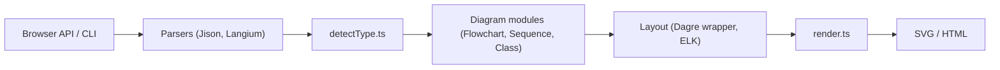

# mermaid-js/mermaid

> JavaScript library that generates diagrams from Markdown-like text, to document code.

## The problem
Diagrams drawn in a graphical tool take a long time to keep up to date and age faster than the code.

## What it actually does
You describe a diagram in text (flowchart, sequence, class, state, Gantt, pie chart, git graph, journey, C4, mindmap...); Mermaid parses it (Jison and Langium), detects the type, builds a model, computes the layout (Dagre or ELK) and renders SVG. Rendering is native in GitHub, there is an online editor (mermaid.live), a sandbox mode against malicious scripts, themes and a configuration.

## How it is wired


## Trying it
The README gives no installation command for users (only `npm publish` for maintainers). Syntax example, from the README:
```
flowchart LR
A[Hard] -->|Text| B(Round)
B --> C{Decision}
C -->|One| D[Result 1]
C -->|Two| E[Result 2]
```

## Cost and gotchas
Free. The README warns that sanitization does not guarantee the absence of vulnerabilities; for content from external users, it suggests rendering in a sandboxed iframe, which blocks some interactions.

## What it is not
Not a free-form drawing tool: the layout is automatic. Nor is it a data modeling or business intelligence tool.

## Alternatives
No alternative named in the README.

## For you
Adopt: text diagrams are versioned with the code and displayed in GitHub, which suits documenting a pipeline or an MLOps flow.
