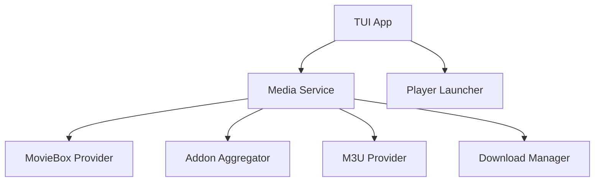

# mesamirh/MovieBox-Tui

> Rust terminal interface to search, download and play movies, series and live TV.

## The problem
Browsing several streaming sources, choosing quality and subtitles, then launching a player forces you to juggle between sites.

## What it actually does
A central service queries providers (MovieBox, 4KHDHub, BDIX, DhakaFlix), Stremio addons and M3U lists. Resolution choice, subtitles, segmented download with resume, launching mpv, VLC or IINA, poster display in Kitty/Sixel. History and favorites stored locally, with no telemetry according to the README.

## How it is wired
Diagram based on the code diagram.



## Trying it
```bash
brew tap mesamirh/moviebox-tui https://github.com/mesamirh/MovieBox-Tui
brew install moviebox-tui
cargo install moviebox-tui --locked
moviebox-tui
```

## Cost and gotchas
Free, Apache-2.0. Depends on third-party sites and scrapers that can break. An external player is needed, and yt-dlp/ffmpeg for some downloads. Installation through `curl | bash` should be read before running. Very recent project.

## What it is not
Not a content host: it reads public streams, but legality depends on the sources used and your jurisdiction.

## Alternatives
No alternative named in the README (it relies on Stremio addons).

## For you
Ignore: a streaming client unrelated to your work, with a legal risk tied to the sources.
