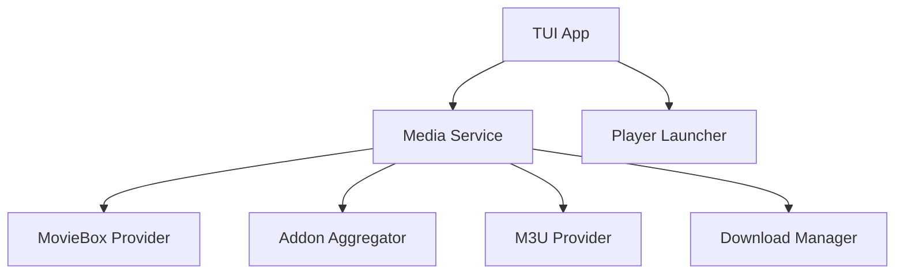

# mesamirh/MovieBox-Tui

> Interface terminal en Rust pour chercher, télécharger et lire films, séries et télé en direct.

## Le problème
Parcourir plusieurs sources de streaming, choisir qualité et sous-titres, puis lancer un lecteur oblige à jongler entre sites.

## Ce que ça fait vraiment
Service central qui interroge des fournisseurs (MovieBox, 4KHDHub, BDIX, DhakaFlix), des addons Stremio et des listes M3U. Choix de résolution, sous-titres, téléchargement par segments avec reprise, lancement de mpv, VLC ou IINA, affichage d'affiches en Kitty/Sixel. Historique et favoris stockés en local, sans télémétrie selon le README.

## Comment c'est branché
Schéma d'après le diagramme du code.



## Essayer
```bash
brew tap mesamirh/moviebox-tui https://github.com/mesamirh/MovieBox-Tui
brew install moviebox-tui
cargo install moviebox-tui --locked
moviebox-tui
```

## Coût et pièges
Gratuit, Apache-2.0. Dépend de sites tiers et de scrapers qui peuvent casser. Il faut un lecteur externe, et yt-dlp/ffmpeg pour certains téléchargements. L'installation par `curl | bash` est à lire avant exécution. Projet très récent.

## Ce que ce n'est pas
Pas un hébergeur de contenu : il lit des flux publics, mais la légalité dépend des sources utilisées et de ta juridiction.

## Alternatives
Aucune alternative nommée dans le README (il s'appuie sur des addons Stremio).

## Pour toi
À ignorer : client de streaming sans lien avec ton métier, avec un risque juridique lié aux sources.

