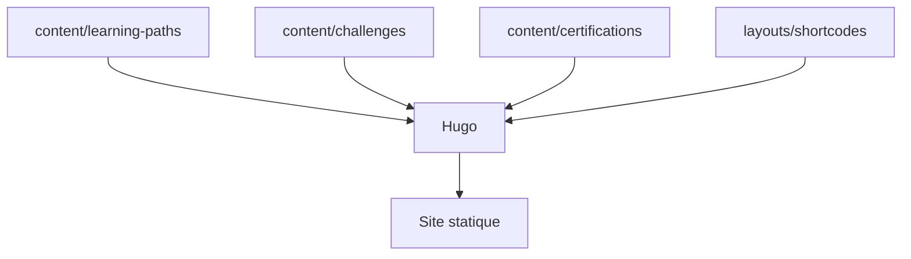

# meshery-extensions/meshery-academy

> Official Meshery training content: learning paths, challenges and certifications, written in Markdown with Hugo.

## The problem
Learning to manage cloud native infrastructure with Meshery requires a structured curriculum, with exercises and assessments.

## What it actually does
The repository contains the academy's learning paths, challenges and certifications, in Markdown with YAML headers and Hugo shortcodes. Assessments (quizzes, tests, exams) are described in YAML. Meshery designs are embedded through a shortcode. A local preview is launched with `make site`.

## How it is wired


## Trying it
```bash
git clone https://github.com/<your-username>/meshery-academy.git
cd meshery-academy
make setup
make site
```

## Cost and gotchas
Go and Node.js required, Hugo is installed through npm. Paid completion certificates belong to the cloud platform, not to this repository.

## What it is not
Not software: it is educational content. The local preview does not have the full academy styling.

## Alternatives
No alternative named in the README.

## For you
Ignore: useful only if you are learning Meshery or want to write courses in this format.
