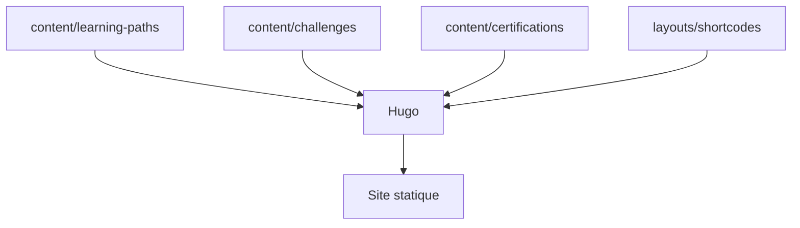

# meshery-extensions/meshery-academy

> Contenu officiel de formation de Meshery : parcours, défis et certifications, rédigés en Markdown avec Hugo.

## Le problème
Apprendre à gérer une infrastructure cloud native avec Meshery demande un cursus structuré, avec exercices et évaluations.

## Ce que ça fait vraiment
Le dépôt contient les parcours, défis et certifications de l'académie, en Markdown avec en-têtes YAML et shortcodes Hugo. Des évaluations (quiz, tests, examens) se décrivent en YAML. Les designs Meshery s'intègrent via un shortcode. Un aperçu local se lance avec `make site`.

## Comment c'est branché


## Essayer
```bash
git clone https://github.com/<your-username>/meshery-academy.git
cd meshery-academy
make setup
make site
```

## Coût et pièges
Go et Node.js requis, Hugo est installé via npm. Les certificats de complétion payants relèvent de la plateforme cloud, pas de ce dépôt.

## Ce que ce n'est pas
Pas un logiciel : c'est du contenu pédagogique. L'aperçu local n'a pas le style complet de l'académie.

## Alternatives
Aucune alternative nommée dans le README.

## Pour toi
À ignorer : utile seulement si tu apprends Meshery ou veux écrire des cours dans ce format.

