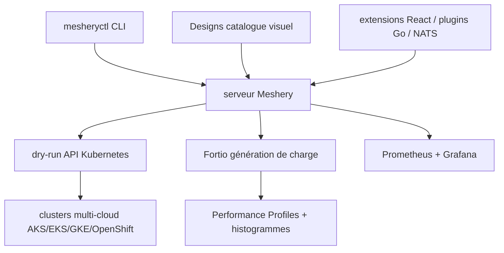

# meshery/meshery

> CNCF platform for visually designing and managing multi-cluster Kubernetes infrastructure.

## The problem
Managing several Kubernetes clusters and hundreds of components amounts to stacking YAML with no overview.
Validating a configuration before applying it, and comparing performance from one version to the next, is done by hand.

## What it actually does
Designs and deploys "Designs" visually, with more than 380 integrations and inferred relationships between components.
Simulates deployments through Kubernetes' native dry-run: syntax validation, detection of missing fields or incompatible API versions, object preview.
Generates load with Fortio (TCP, gRPC, HTTP), stores Performance Profiles, does statistical analysis with latency histograms and compares tests against each other.
Plugs into Prometheus and Grafana for cluster and application metrics; Workspaces organize team work and access.

## How it is wired


## Trying it
```bash
curl -L https://meshery.io/install | bash -
git clone --no-checkout --filter=blob:none https://github.com/meshery/meshery.git
cd meshery
git sparse-checkout set --no-cone '/*' '!/models/*' '/models/meshery-core/' '/models/kubernetes/' '!/docs/static/v0.8/'
git checkout master
```

## Cost and gotchas
The core is open, but several described features (Workspaces, multiplayer, snapshots in PRs) go through Meshery extensions: consider it freemium.
Starting gotcha: a full clone weighs tens of gigabytes because of `models/` and the docs archives — the README recommends the sparse clone.

## What it is not
Not a service mesh: it is a cloud-native infrastructure manager that drives several.
Not a lightweight tool: a server, an integrations base, extensions; it is not `kubectl apply`.
Not a GitOps replacement: it describes itself as "GitOps-centric", so a complement to your repositories.

## Alternatives
No alternative named in the README.

## For you
Worth watching if you operate several clusters; for single-cluster MLOps use, it is oversized.
