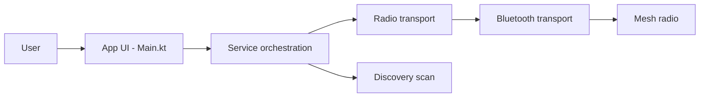

# meshtastic/Meshtastic-Android

> Android and desktop client for communicating through open-source Meshtastic mesh radios.

## The problem
LoRa mesh radios are hard to operate without an interface: messages, nodes, channels and configuration require a dedicated application.

## What it actually does
Kotlin Multiplatform application (Compose, Koin, Room, Kable for Bluetooth) linked to a device over BLE, USB or TCP. Network discovery, maps and geofences, encrypted key backup, NFC sharing, packet signature indicators, air quality telemetry, firmware updates, Wi-Fi provisioning, a local TAK server and system assistant features.

## How it is wired


## Trying it
```bash
./gradlew publishDocsSite -Pdocs.channel=root
./gradlew :dokkaGeneratePublicationHtml
# Compilation : clé Google Maps dans secrets.properties (MAPS_API_KEY=...)
```

## Cost and gotchas
Free. The `google` flavor adds Google Maps, Firebase Crashlytics, Datadog and Google AI features; `fdroid` has none. A compatible radio device is required. Without a Maps key, the build succeeds but without map backgrounds.

## What it is not
Not the firmware (another repository) nor an online service: it is the client. Without a radio, it is useless.

## Alternatives
None named in the README.

## For you
Ignore: a mesh radio client, unrelated to data/AI/MLOps; only the `fdroid` flavor avoids telemetry.
