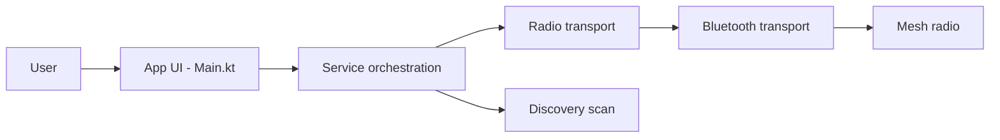

# meshtastic/Meshtastic-Android

> Client Android et bureau pour communiquer via des radios maillées Meshtastic open source.

## Le problème
Les radios maillées LoRa se pilotent mal sans interface : messages, nœuds, canaux et configuration demandent une application dédiée.

## Ce que ça fait vraiment
Application Kotlin Multiplatform (Compose, Koin, Room, Kable pour le Bluetooth) liée à un appareil par BLE, USB ou TCP. Découverte de réseaux, cartes et geofences, sauvegarde chiffrée des clés, partage NFC, indicateurs de signature de paquets, télémétrie de qualité de l'air, mises à jour de firmware, provisionnement Wi-Fi, serveur TAK local et fonctions d'assistant système.

## Comment c'est branché


## Essayer
```bash
./gradlew publishDocsSite -Pdocs.channel=root
./gradlew :dokkaGeneratePublicationHtml
# Compilation : clé Google Maps dans secrets.properties (MAPS_API_KEY=...)
```

## Coût et pièges
Gratuit. Le flavor `google` ajoute Google Maps, Firebase Crashlytics, Datadog et des fonctions IA Google ; `fdroid` n'en a aucun. Il faut un appareil radio compatible. Sans clé Maps, la compilation passe mais sans fonds de carte.

## Ce que ce n'est pas
Pas le firmware (autre dépôt) ni un service en ligne : c'est le client. Sans radio, il ne sert à rien.

## Alternatives
Aucune nommée dans le README.

## Pour toi
Ignorer : client de radio maillée, sans lien avec data/IA/MLOps ; seul le flavor `fdroid` évite la télémétrie.

