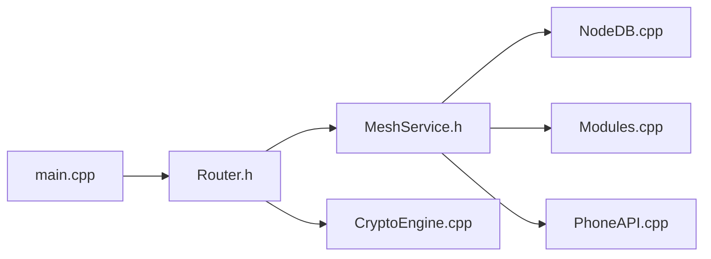

# meshtastic/firmware

> Official firmware of the Meshtastic LoRa mesh network, for messages and position without Internet.

## The problem
Communicating in the wilderness or in an emergency without a cellular network or Internet.

## What it actually does
Embedded firmware for ESP32, nRF52, RP2040/RP2350 and Linux: LoRa radio packet routing, encryption, node database, GPS, power management, screen and menus, feature modules (messaging, telemetry) and an API to the mobile app.

## How it is wired

## Trying it
No documented command: the README points to the "Building Instructions" and "Flashing Instructions" pages.

## Cost and gotchas
Free; you need LoRa-compatible hardware. GPL-3.0 licence.

## What it is not
Not PC software: it runs on radio boards. The README is short, so there is little detail on real-world range.

## Alternatives
- No alternative named in the README.

## For you
Ignore: LoRa connected devices, with no direct link to data/AI.
