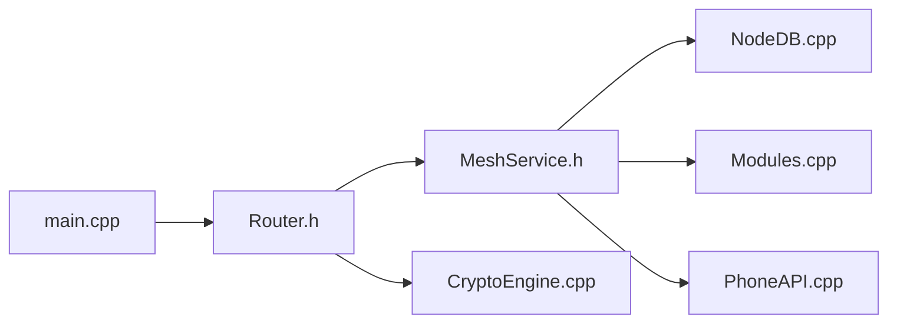

# meshtastic/firmware

> Firmware officiel du réseau maillé LoRa Meshtastic, pour messages et position hors Internet.

## Le problème
Communiquer en pleine nature ou en situation d'urgence sans réseau cellulaire ni Internet.

## Ce que ça fait vraiment
Firmware embarqué pour ESP32, nRF52, RP2040/RP2350 et Linux : routage de paquets radio LoRa, chiffrement, base de nœuds, GPS, gestion d'énergie, écran et menus, modules de fonctions (messagerie, télémétrie) et API vers l'application mobile.

## Comment c'est branché

## Essayer
Aucune commande documentée : le README renvoie aux pages « Building Instructions » et « Flashing Instructions ».

## Coût et pièges
Gratuit ; il faut du matériel compatible LoRa. Licence GPL-3.0.

## Ce que ce n'est pas
Pas un logiciel pour PC : il tourne sur cartes radio. Le README est court, donc peu de détails sur la portée réelle.

## Alternatives
- Aucune alternative nommée dans le README.

## Pour toi
À ignorer : objets connectés LoRa, sans lien direct avec la data/IA.

