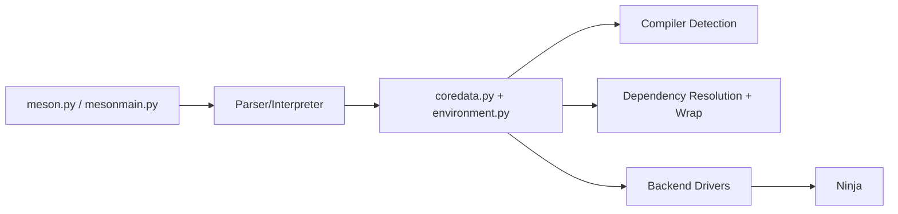

# mesonbuild/meson

> Python build system that generates Ninja files from `meson.build`, for C/C++ and other projects.

## The problem
C/C++ builds based on Makefiles or CMake are verbose, slow to configure and hard to make portable.

## What it actually does
Meson reads a `meson.build` file, detects compilers and dependencies (with "wrap" subprojects), then generates the files for a backend, Ninja first and foremost, also Visual Studio or Xcode. It enforces a build directory separate from the source. Requires Python 3.10+ and Ninja 1.8.2+.

## How it is wired


## Trying it
```bash
python3 -m pip install meson
python3 -m pip install ninja
cd <source root>
meson setup builddir
ninja
ninja test
```

## Cost and gotchas
Free, Apache-2.0. Ninja and a compiler are required. Old Python versions are pinned to old Meson versions (e.g. 1.11 for Python 3.7–3.9).

## What it is not
Not a package manager nor a compiler: it orchestrates. Many open issues (2,256), a sign of a very broad project.

## Alternatives
None named in the README.

## For you
Watch: useful if you compile C/C++ or Rust extensions for Python/ML, otherwise outside your daily scope.
