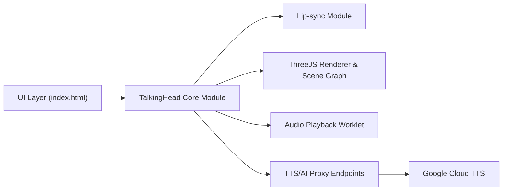

# met4citizen/TalkingHead

> JavaScript class for a 3D avatar that talks and lip-syncs in the browser.

## The problem
Giving an animated face to a conversational agent requires speech synthesis, visemes, 3D rendering and body animation.

## What it actually does
Loads a GLB avatar with a Mixamo rig, ARKit blendshapes and Oculus visemes, renders with Three.js, plays the voice with native lip-sync (English, German, French, Finnish, Lithuanian). Uses Google Cloud TTS by default; ElevenLabs, Azure or OpenAI via a test application. Audio streaming mode, dynamic bones, gestures, moods. Companion modules: HeadTTS (Kokoro, in the browser), HeadAudio, MotionEngine.

## How it is wired


## Trying it
```bash
git clone --depth 1 https://github.com/met4citizen/TalkingHead.git && rm -r TalkingHead/.git
```
```javascript
import { TalkingHead } from "talkinghead";
const head = new TalkingHead(nodeAvatar, { ttsEndpoint: "/gtts/", jwtGet: jwtGet, lipsyncModules: ["en", "fi"] });
```

## Cost and gotchas
Google TTS offers 4 million free characters per month according to the author, billed beyond that; he advises against putting an API key on the client side (JWT proxy described). Check avatar licenses (often non-commercial).

## What it is not
Not an agent: no conversation logic. You have to supply the voice and the AI.

## Alternatives
No alternative named in the README.

## For you
Worth watching: a useful building block for a voice assistant demo, but a 3D front end with TTS costs and avatar licenses to scope.
