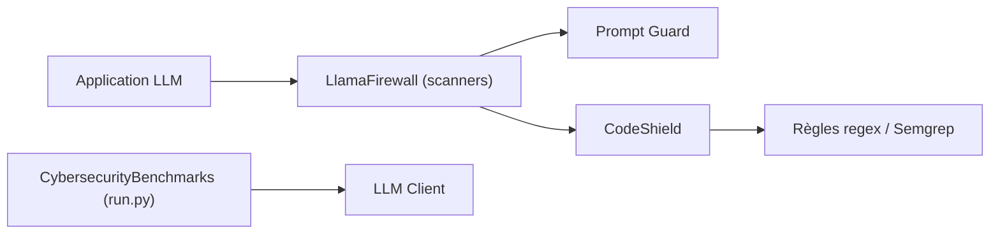

# meta-llama/PurpleLlama

> Meta's set of tools and evaluations to secure the inputs and outputs of generative models.

## The problem
LLM applications produce unsafe code, suffer prompt injections and can assist cyberattacks.

## What it actually does
The README presents Llama Guard 3 (input/output moderation), Prompt Guard (detection of injections and jailbreaks), Code Shield (filtering of unsafe code at inference) and the CyberSec Eval v1 to v3 benchmarks. According to the code, the monorepo also contains LlamaFirewall (pluggable scanners) and a classification of sensitive documents on Google Drive. The models are on Hugging Face.

## How it is wired


## Trying it
```bash
# Le README renvoie aux ressources du dépôt Llama-recipe et à
# l'exemple CodeShield (notebook). Aucune commande n'y figure.
```

## Cost and gotchas
The benchmarks call LLMs (API or local models); the Guard models require a GPU. The license is present but not identified by GitHub: read it before any use, notably for the models.

## What it is not
Not a turnkey solution: each component is integrated by yourself. The benchmarks measure risk, they do not remove it.

## Alternatives
No alternative named in the README.

## For you
Worth watching: Prompt Guard, Llama Guard and CyberSec Eval are useful to evaluate and protect an LLM application, but read the exact license before embedding them.
