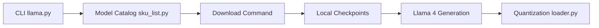

# meta-llama/llama-models

> Meta repository: CLI to download Llama weights and native inference code for Llama 3 and 4.

## The problem
Obtaining, verifying and running the official Llama weights requires a licensing process and dedicated scripts.

## What it actually does
The `llama-model` CLI lists, describes, downloads, verifies and removes models; the weights are obtained after accepting the Meta license (signed URL valid for 24 h). The code provides Llama 3/4 inference, Llama 4 image preprocessing and FP8/Int4 quantization.

## How it is wired


## Trying it
```bash
pip install llama-models
llama-model list
llama-model download --source meta --model-id CHOSEN_MODEL_ID
pip install .[torch]
```

## Cost and gotchas
Llama 4 Scout requires 4 GPUs in bf16, 2 80 GB GPUs in FP8 or 1 80 GB GPU in Int4. Access is subject to approval and to the usage policy.

## What it is not
Not open source in the strict sense: the weights have their own license. The repository's license is not identified by GitHub.

## Alternatives
Points to Llama Stack to run the models via other providers.

## For you
Keep an eye on it: official source of the weights, but for day-to-day inference, go through a dedicated server; check the license before any commercial use.
