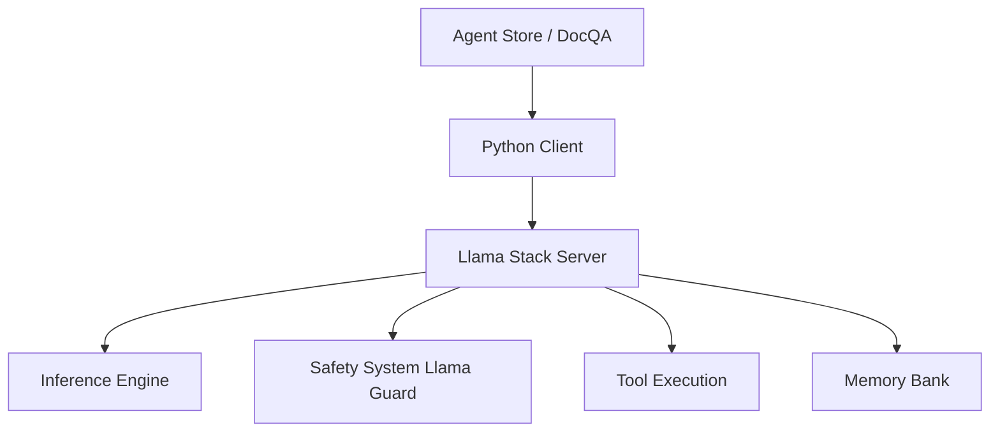

# meta-llama/llama-stack-apps

> Example agent applications (Llama 3.1) that talk to a Llama Stack server.

## The problem
Knowing concretely how to plug an agent (tools, safety, RAG) into a Llama Stack server.

## What it actually does
Example scripts: a simple agent (`examples.agents.hello`), a RAG with a vector database, a Gradio chat app (agent_store). The agents use Llama Guard as a safeguard and tools like Brave Search or WolframAlpha, via a server on port 8321. The diagrams also mention mobile demos (iOS, Android).

## How it is wired


## Trying it
```bash
conda create -n stack python=3.10
pip install -r requirements.txt
export TAVILY_SEARCH_API_KEY=[KEY]
python -m examples.agents.hello localhost 8321
```

## Cost and gotchas
You must first start a Llama Stack server (separate repository). Tavily/Brave/Wolfram keys for the tools. Conda required to install a distribution.

## What it is not
Not a framework: examples tied to the 2024 Llama Stack API, probably outdated by the rename to OGX.

## Alternatives
- llama-stack: the server itself, to be preferred to start from the right side.

## For you
Ignore: dated examples depending on a server that has since been renamed; read the current server's documentation instead.
