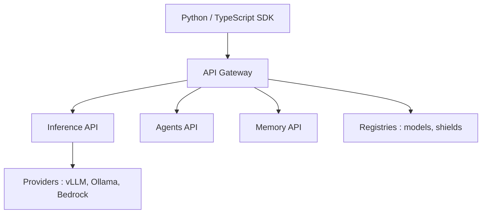

# meta-llama/llama-stack

> OpenAI-compatible API server, renamed OGX, for running agent applications on any model.

## The problem
Every model provider has its own API; switching models or infrastructure forces you to rewrite the application.

## What it actually does
OGX exposes OpenAI endpoints (chat, embeddings, Responses API, vector stores, files, batches), plus Anthropic (/v1/messages) and Google GenAI. It routes to pluggable providers (Ollama, vLLM…). The Responses API handles server-side orchestration: tool calling, MCP, file search (RAG). Versioned "skills" are managed under /v1alpha.

## How it is wired

(Components from a diagram dating from the Llama Stack era; the current README describes OGX.)

## Trying it
```bash
uv pip install ogx
uv run ogx go
```

## Cost and gotchas
Free, but you need an inference provider behind it (local Ollama, vLLM, cloud). The project has changed name and mission: cross-check the original repo against ogx-ai/ogx.

## What it is not
Not a model nor an agent library: it is the server that hosts them. The diagram provided is old compared to the README.

## Alternatives
- No alternative named in the README.

## For you
Keep an eye on it: a multi-provider OpenAI-compatible gateway is useful in MLOps, but the renaming and the alpha status of skills suggest waiting for things to stabilize.
