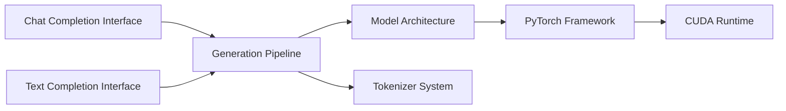

# meta-llama/llama

> Minimal Llama 2 inference code, deprecated in favor of the Llama Stack repositories.

## The problem
Loading the official Llama 2 weights and running a local reference inference.

## What it actually does
`model.py`, `tokenizer.py`, `generation.py` and two examples (text completion, chat) launched via `torchrun`.
Models from 7B to 70B; model parallelism MP = 1, 2 or 8 depending on size; 4096-token context.
Weights are downloaded via `download.sh` and a signed URL received by e-mail after accepting the license.
**Deprecated** since Llama 3.1.

## How it is wired


## Trying it
```bash
pip install -e .
./download.sh
torchrun --nproc_per_node 1 example_chat_completion.py --ckpt_dir llama-2-7b-chat/ --tokenizer_path tokenizer.model --max_seq_len 512 --max_batch_size 6
```

## Cost and gotchas
GPU + CUDA; registration with Meta, download links expiring after 24 h. Last push in January 2025.

## What it is not
Not the current Llama repository. No fine-tuning or serving tooling. Meta's own license, not identified by GitHub.

## Alternatives
- meta-llama/llama-models: weights, model cards, license.
- meta-llama/llama-cookbook: community scripts and integrations.
- meta-llama/PurpleLlama: safety and guardrails.

## For you
Historical archive; ignore it, go through llama-models or Hugging Face.
