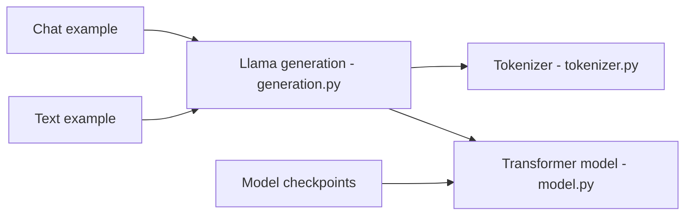

# meta-llama/llama3

> Obsolete minimal inference repository for Llama 3 (8B and 70B), replaced by other Meta repositories.

## The problem
Load and query the Llama 3 weights locally with simple reference code.

## What it actually does
Examples `example_chat_completion.py` and `example_text_completion.py` launched via `torchrun`, with a tokenizer (tiktoken), chat formatting and a Transformer. The weights are requested on Meta's site (signed URL sent by email, valid for 24 h) or on Hugging Face after accepting the license.

## How it is wired


## Trying it
```bash
pip install -e .
torchrun --nproc_per_node 1 example_chat_completion.py \
    --ckpt_dir Meta-Llama-3-8B-Instruct/ \
    --tokenizer_path Meta-Llama-3-8B-Instruct/tokenizer.model \
    --max_seq_len 512 --max_batch_size 6
```

## Cost and gotchas
GPU required (8B: 1 GPU, 70B: 8 according to the MP table). Access to the weights is subject to a request and acceptance of the license. Repository archived, last push in January 2025.

## What it is not
Not the repository to use today: the README itself declares it deprecated in favor of llama-models, PurpleLlama, llama-toolchain, llama-agentic-system and llama-cookbook.

## Alternatives
- llama-models: central repository for the foundation models.
- llama-cookbook: community scripts and integrations.
- llama-toolchain: inference, fine-tuning, safety.

## For you
Ignore: archived and deprecated by its authors; start from the replacement repositories or from Hugging Face.
