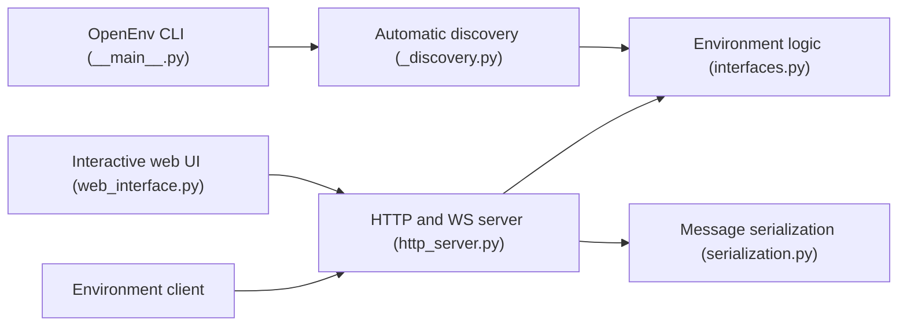

# meta-pytorch/OpenEnv

> Framework to create, deploy and use isolated environments for agentic reinforcement learning training.

## The problem
Each agentic RL framework invents its own environment interfaces, which are hard to isolate and share.

## What it actually does
Gymnasium-style interface (`reset()`, `step()`, `state()`): a FastAPI server in a Docker container hosts the environment, and a client (asynchronous by default, `.sync()` available) talks to it over WebSocket. The `openenv` CLI creates, builds, serves, validates, imports and pushes environments to Hugging Face Spaces. Examples: Echo, Coding, Chess, Atari, FinRL; integrations with TRL, torchforge, Unsloth, SkyRL, ART, Oumi.

## How it is wired


## Trying it
```bash
pip install openenv
pip install git+https://huggingface.co/spaces/openenv/echo_env
openenv init my_game_env
openenv push
```

## Cost and gotchas
Free; Docker to host environments locally. The README warns of an experimental stage: bugs and APIs subject to change.

## What it is not
Not a training framework: it provides the environments, training happens elsewhere (TRL, torchforge...). The Kubernetes provider is "planned".

## Alternatives
No alternative named in the README.

## For you
Worth watching: promising standard if you do RL for LLMs, but unstable at this stage.
