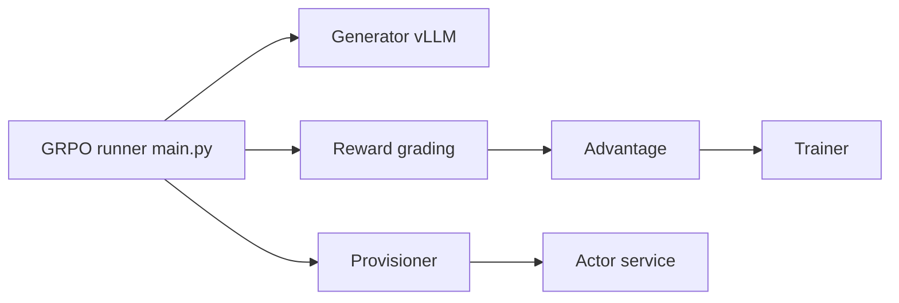

# meta-pytorch/torchforge

> PyTorch library for agentic reinforcement learning, separating the algorithm from the distributed infrastructure.

## The problem
Experimenting with RL on LLMs forces you to mix algorithm, GPU placement, fault tolerance and communication.

## What it actually does
Provides RL abstractions (rewards, advantages, collation, losses) and distributed actors/services (provisioner, router, replicas), with vLLM for generation and torchtitan for training. Two entry points: GRPO (`apps/grpo`) and SFT (`apps/sft`). The README states that development is paused, PyTorch's LLM training being consolidated in torchtitan.

## How it is wired


## Trying it
```bash
conda create -n forge python=3.12
conda activate forge
./scripts/install.sh
python -m apps.grpo.main --config apps/grpo/qwen3_1_7b.yaml
python -m apps.sft.main --config apps/sft/llama3_8b.yaml
```

## Cost and gotchas
At least 2 GPUs for GRPO; depends on PyTorch 2.9.0, Monarch, vLLM, torchtitan. Installation through a DNF/conda script; uv does not work.

## What it is not
No longer an active project: development is paused. Not a tool ready for a laptop.

## Alternatives
- torchtitan: cited as the destination of the consolidation.

## For you
Ignore for a new project: development is paused, better to follow torchtitan; useful reading only for the RL abstractions.
