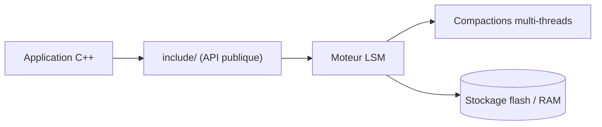

# meta/rocksdb

> C++ library for persistent LSM-style key-value storage, designed for flash drives and large volumes.

## The problem
Storing several terabytes of key-value pairs with fast writes calls for a tunable embedded engine, not yet another server.

## What it actually does
Embedded library with a Log-Structured-Merge architecture, with multi-threaded compactions and tunable trade-offs between write, read and space amplification. Derived from LevelDB. The public interface is in `include/`; the other headers are internal and may change without notice.

## How it is wired

Diagram inferred from the README (no diagram provided).

## Trying it
```bash
# exemples : https://github.com/meta/rocksdb/tree/main/examples
```
No build command in the README provided.

## Cost and gotchas
Free. You have to build it and tune the compaction parameters yourself. License given as GPL-2.0 by the catalog: to be validated for any distributed product.

## What it is not
Not a database server: a library to integrate. No usage documentation in the README, which points to the wiki.

## Alternatives
- LevelDB: cited ancestor, simpler.

## For you
Worth watching: a low-level building block often embedded in other tools, rarely to be used directly in data/AI; the indicated copyleft license weighs on redistribution.
