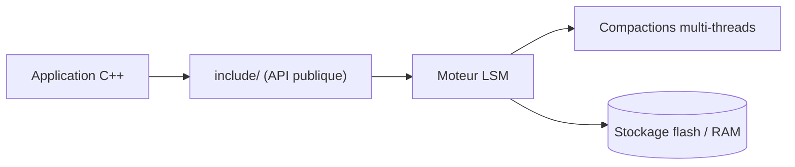

# meta/rocksdb

> Bibliothèque C++ de stockage clé-valeur persistant de type LSM, pensée pour disques flash et gros volumes.

## Le problème
Stocker plusieurs téraoctets de paires clé-valeur avec écritures rapides demande un moteur embarqué réglable, pas un serveur de plus.

## Ce que ça fait vraiment
Bibliothèque embarquée à architecture Log-Structured-Merge, avec compactions multi-threads et compromis réglables entre amplification d'écriture, de lecture et d'espace. Dérivée de LevelDB. L'interface publique est dans `include/` ; les autres en-têtes sont internes et peuvent changer sans préavis.

## Comment c'est branché

Schéma déduit du README (aucun diagramme fourni).

## Essayer
```bash
# exemples : https://github.com/meta/rocksdb/tree/main/examples
```
Aucune commande de build dans le README fourni.

## Coût et pièges
Gratuit. Il faut compiler et régler soi-même les paramètres de compaction. Licence indiquée GPL-2.0 par le catalogue : à valider pour tout produit distribué.

## Ce que ce n'est pas
Pas un serveur de base de données : une bibliothèque à intégrer. Pas de documentation d'usage dans le README, qui renvoie au wiki.

## Alternatives
- LevelDB : ancêtre cité, plus simple.

## Pour toi
À surveiller : brique de bas niveau souvent embarquée dans d'autres outils, rarement à utiliser directement en data/IA ; la licence copyleft indiquée pèse sur la redistribution.

