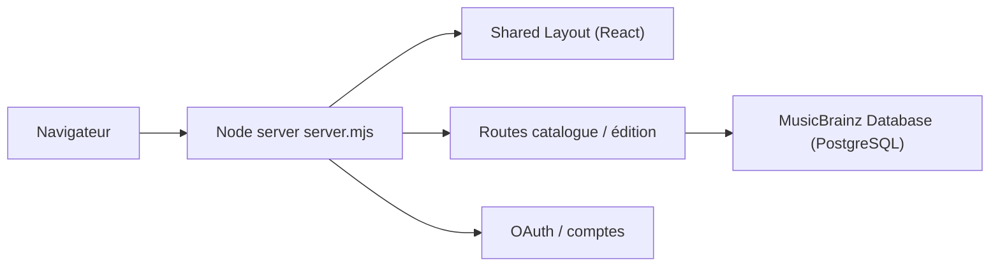

# metabrainz/musicbrainz-server

> Web server of MusicBrainz, an open, community-driven music metadata database.

## The problem
Reliable, open music metadata is scattered; MusicBrainz centralizes it in a public relational database.

## What it actually does
Web frontend of the MusicBrainz database: clustered Node server, React pages, catalog (artists, releases, recordings), ISRC identifiers, relationships, community editing, accounts, OAuth, reports, statistics, CD identification. PostgreSQL behind it. README prerequisites: Ubuntu/Debian, Node 24, Perl 5.42, PostgreSQL 18.

## How it is wired

## Trying it
No command in the README; full instructions are in INSTALL.md (not provided).

## Cost and gotchas
Heavy stack (recent Node, Perl, PostgreSQL), Unix only. License announced as GPLv2 or later in the README, not identified by GitHub: to be verified.

## What it is not
Not the data alone: it is the server. The API and schema may change, announced on the blog.

## Alternatives
None named in the README.

## For you
Worth watching if you want an open music reference for datasets; self-hosting is heavy, the public API is often enough.
