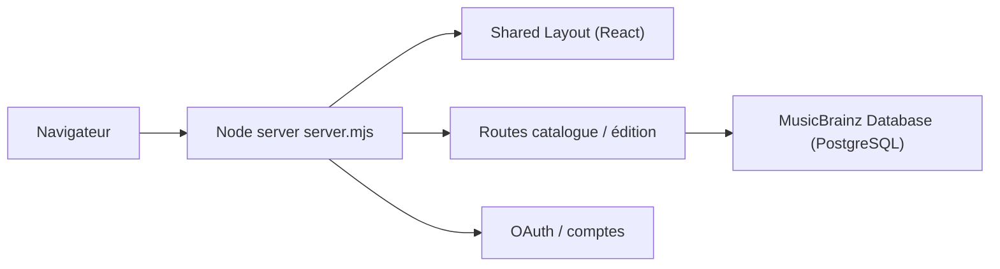

# metabrainz/musicbrainz-server

> Serveur web de MusicBrainz, base ouverte et communautaire de métadonnées musicales.

## Le problème
Les métadonnées musicales fiables et ouvertes sont dispersées ; MusicBrainz les centralise en base relationnelle publique.

## Ce que ça fait vraiment
Frontend web de la base MusicBrainz : serveur Node clusterisé, pages React, catalogue (artistes, sorties, enregistrements), identifiants ISRC, relations, édition communautaire, comptes, OAuth, rapports, statistiques, identification de CD. PostgreSQL derrière. Prérequis du README : Ubuntu/Debian, Node 24, Perl 5.42, PostgreSQL 18.

## Comment c'est branché

## Essayer
Aucune commande dans le README ; les instructions complètes sont dans INSTALL.md (non fourni).

## Coût et pièges
Pile lourde (Node, Perl, PostgreSQL récents), Unix seulement. Licence annoncée GPLv2 ou ultérieure dans le README, non identifiée par GitHub : à vérifier.

## Ce que ce n'est pas
Pas les données seules : c'est le serveur. L'API et le schéma peuvent changer, annoncés sur le blog.

## Alternatives
Aucune nommée dans le README.

## Pour toi
À surveiller si tu veux un référentiel musical ouvert pour des jeux de données ; l'auto-hébergement est lourd, l'API publique suffit souvent.

