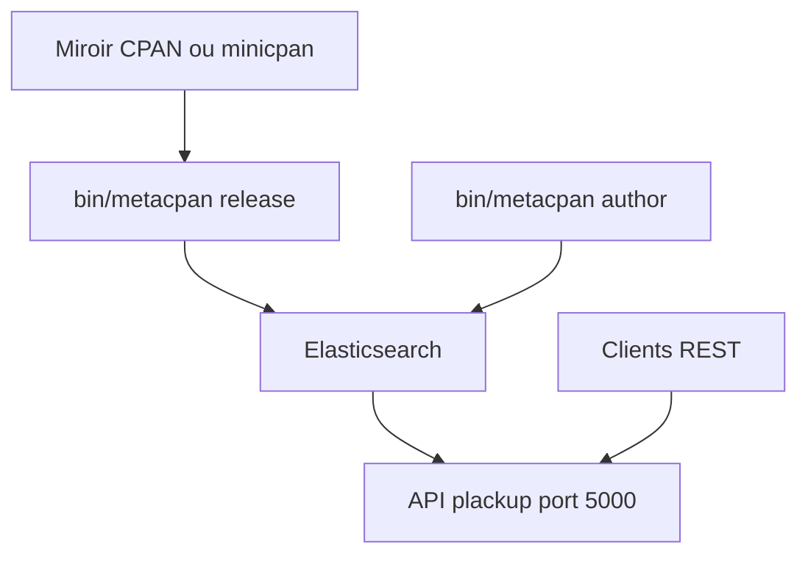

# metacpan/metacpan-api

> REST web service, based on Elasticsearch, that provides metadata for Perl's CPAN modules.

## The problem
Searching and querying CPAN's Perl modules requires a structured, open metadata index.

## What it actually does
Indexes CPAN releases (or a minicpan mirror) into Elasticsearch and exposes a REST API and complex queries. Authors can enrich their profile. Command-line tools to create the mapping, index releases, flag the latest ones and index authors. Plack server.

## How it is wired
Simplified diagram based on the sheet, no diagram provided.



## Trying it
```bash
./bin/run bin/metacpan mapping --delete
./bin/run bin/metacpan release /path/to/cpan/authors/id/
./bin/run plackup -p 5000 -r
./bin/prove t
```

## Cost and gotchas
Elasticsearch required, hungry for memory and file descriptors for an entire CPAN. Perl needed (missing from the prerequisites list). The README points to `metacpan-docker` for a local installation; some instructions are old (Java 6).

## What it is not
Not a CPAN client. The license is present but not identified by GitHub: check it before any use.

## Alternatives
- metacpan-docker: the recommended route for a local instance.

## For you
Ignore: Perl ecosystem, unrelated to your data / AI stack, unless you query the public CPAN API.
