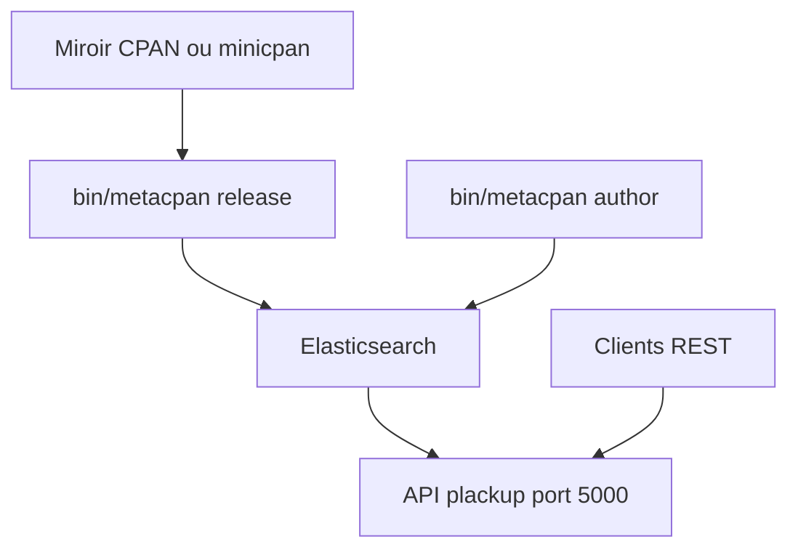

# metacpan/metacpan-api

> Service web REST, basé sur Elasticsearch, qui fournit les métadonnées des modules CPAN de Perl.

## Le problème
Chercher et interroger les modules Perl du CPAN demande un index de métadonnées structuré et ouvert.

## Ce que ça fait vraiment
Indexe les versions du CPAN (ou un miroir minicpan) dans Elasticsearch et expose une API REST et des requêtes complexes. Les auteurs peuvent enrichir leur profil. Outils en ligne de commande pour créer le mapping, indexer les versions, marquer les dernières et indexer les auteurs. Serveur Plack.

## Comment c'est branché
Schéma simplifié d'après la fiche, sans diagramme fourni.



## Essayer
```bash
./bin/run bin/metacpan mapping --delete
./bin/run bin/metacpan release /path/to/cpan/authors/id/
./bin/run plackup -p 5000 -r
./bin/prove t
```

## Coût et pièges
Elasticsearch requis, gourmand en mémoire et en descripteurs de fichiers pour un CPAN entier. Perl nécessaire (absent de la liste des prérequis). Le README renvoie vers `metacpan-docker` pour une installation locale ; des instructions sont anciennes (Java 6).

## Ce que ce n'est pas
Pas un client CPAN. La licence est présente mais non identifiée par GitHub : à vérifier avant tout usage.

## Alternatives
- metacpan-docker : voie conseillée pour une instance locale.

## Pour toi
Ignorer : écosystème Perl, sans lien avec ta pile data / IA, sauf si tu consultes l'API publique du CPAN.

