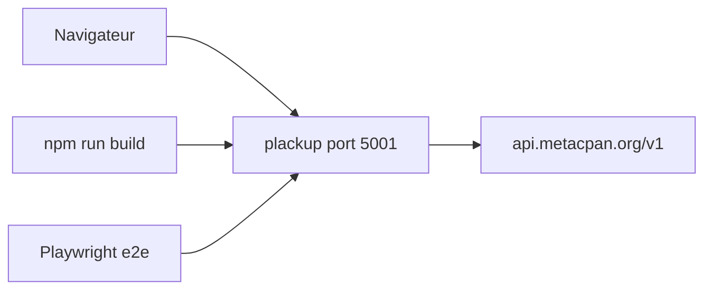

# metacpan/metacpan-web

> Web interface of MetaCPAN, the search engine for Perl modules.

## The problem
Browsing and searching CPAN's Perl modules without a dedicated search engine.

## What it actually does
Perl (Plack) application that queries the MetaCPAN API. The README only describes development: installation, tests, Playwright end-to-end tests, lint with precious. The repository has existed since 2011.

## How it is wired
Simplified diagram based on the sheet, no diagram provided.


## Trying it
```bash
carton install
npm install
npm run build
carton exec plackup -p 5001 -r
```

## Cost and gotchas
Free. Requires Perl, carton and Node; Perl is not in the list of prerequisites, yet it is the real requirement. Docker Compose is recommended. The license is not identified by GitHub.

## What it is not
Not a reusable tool: it is the website of a specific service. The README does not present the service for the end user.

## Alternatives
- metacpan-docker: development environment recommended by the README.

## For you
Ignore: contribution repository for the Perl ecosystem, outside the data/AI/MLOps scope.
