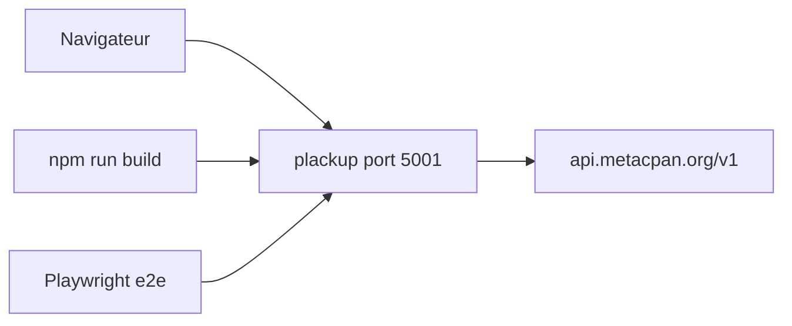

# metacpan/metacpan-web

> Interface web de MetaCPAN, le moteur de recherche des modules Perl.

## Le problème
Parcourir et chercher les modules Perl du CPAN sans moteur dédié.

## Ce que ça fait vraiment
Application Perl (Plack) qui interroge l'API de MetaCPAN. Le README ne décrit que le développement : installation, tests, tests de bout en bout Playwright, lint avec precious. Le dépôt existe depuis 2011.

## Comment c'est branché
Schéma simplifié d'après la fiche, sans diagramme fourni.


## Essayer
```bash
carton install
npm install
npm run build
carton exec plackup -p 5001 -r
```

## Coût et pièges
Gratuit. Demande Perl, carton et Node ; Perl n'est pas dans la liste des prérequis, c'est le vrai besoin. Docker Compose est recommandé. La licence n'est pas identifiée par GitHub.

## Ce que ce n'est pas
Pas un outil réutilisable : c'est le site d'un service précis. Le README ne présente pas le service pour l'utilisateur final.

## Alternatives
- metacpan-docker : environnement de développement conseillé par le README.

## Pour toi
À ignorer : dépôt de contribution pour l'écosystème Perl, hors du champ data/IA/MLOps.

