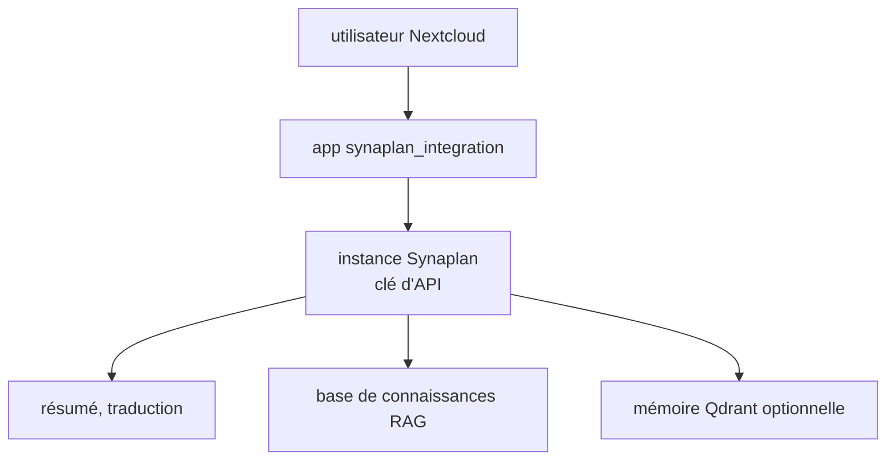

# metadist/synaplan-nextcloud

> Nextcloud app that adds summarization, translation, a RAG knowledge base and chat through a Synaplan instance.

## The problem
Summarizing, translating or querying your Nextcloud files with AI forces you to leave Nextcloud and copy the documents.

## What it actually does
File context menu: summary, translation, add to the knowledge base (RAG). Streaming search chat with model choice, `/pic` and `/vid` commands. Multi-task routing is done on the Synaplan instance side. Three modes: shared key, per-user account creation, linking of an existing account.

## How it is wired
Simplified diagram based on the sheet, no diagram provided.


## Trying it
```bash
wget https://github.com/metadist/synaplan-nextcloud/releases/latest/download/synaplan_integration.tar.gz
tar -xzf synaplan_integration.tar.gz -C /path/to/nextcloud/custom_apps/
php /path/to/nextcloud/occ app:enable synaplan_integration
```

## Cost and gotchas
Requires Nextcloud 33 to 35, PHP 8.2+ and a Synaplan instance with an API key. Model costs are on the Synaplan side, not detailed.

## What it is not
Not an AI engine: all the work goes through Synaplan. Without that instance, the app does nothing.

## Alternatives
Not documented in the README.

## For you
Worth watching: interesting if you host Nextcloud and Synaplan, since it plugs a RAG onto your files; otherwise too tightly coupled.
