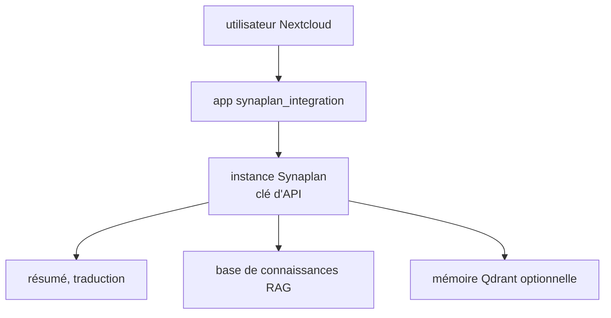

# metadist/synaplan-nextcloud

> Application Nextcloud qui ajoute résumé, traduction, base de connaissances RAG et chat via une instance Synaplan.

## Le problème
Résumer, traduire ou interroger ses fichiers Nextcloud avec une IA oblige à sortir de Nextcloud et à copier les documents.

## Ce que ça fait vraiment
Menu contextuel de fichiers : résumé, traduction, ajout à la base de connaissances (RAG). Chat de recherche en streaming avec choix de modèle, commandes `/pic` et `/vid`. Le routage multi-tâches est fait côté instance Synaplan. Trois modes : clé partagée, création de compte par utilisateur, liaison de compte existant.

## Comment c'est branché
Schéma simplifié d'après la fiche, sans diagramme fourni.


## Essayer
```bash
wget https://github.com/metadist/synaplan-nextcloud/releases/latest/download/synaplan_integration.tar.gz
tar -xzf synaplan_integration.tar.gz -C /path/to/nextcloud/custom_apps/
php /path/to/nextcloud/occ app:enable synaplan_integration
```

## Coût et pièges
Nécessite Nextcloud 33 à 35, PHP 8.2+ et une instance Synaplan avec clé d'API. Coûts des modèles côté Synaplan, non détaillés.

## Ce que ce n'est pas
Pas un moteur d'IA : tout le travail passe par Synaplan. Sans cette instance, l'extension ne fait rien.

## Alternatives
Non documenté dans le README.

## Pour toi
À surveiller : intéressant si tu héberges Nextcloud et Synaplan, car il branche un RAG sur tes fichiers ; sinon trop couplé.

