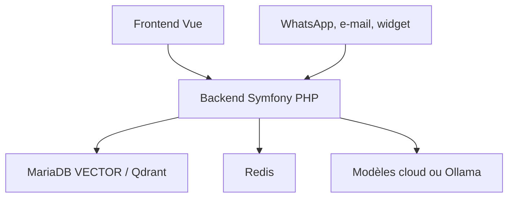

# metadist/synaplan

> Open source platform for AI assistants over your documents, available on the web, WhatsApp, e-mail and Nextcloud.

## The problem
Deploying the same assistant, with the same knowledge and rules, across several work channels requires a lot of integrations.

## What it actually does
Web chat and administration interface, search across your files (MariaDB VECTOR or Qdrant), model choice per task (OpenAI, Anthropic, Mistral, local Ollama), cost shown per answer, human validation of actions. Site widget, WhatsApp, e-mail, Outlook, MCP server and Anthropic-compatible API.

## How it is wired


## Trying it
```bash
git clone https://github.com/metadist/synaplan.git
cd synaplan
make up
```

## Cost and gotchas
Docker Compose v2 and 8 GB of RAM; first start takes 5 to 15 minutes. The demo account is `admin@synaplan.com` / `admin123`: do not keep it on a server. Model keys are billed to you; the hosted offer is paid.

## What it is not
Not a simple chat: several containers. The README admits that Open WebUI or LibreChat is enough for a plain chat window.

## Alternatives
- Open WebUI: simpler for a chat alone.
- LibreChat: multi-provider chat, faster to start.
- Dify: more of an application and workflow builder.

## For you
Watch: useful for a self-hosted multi-channel RAG assistant, but heavy to set up for simple personal use.
