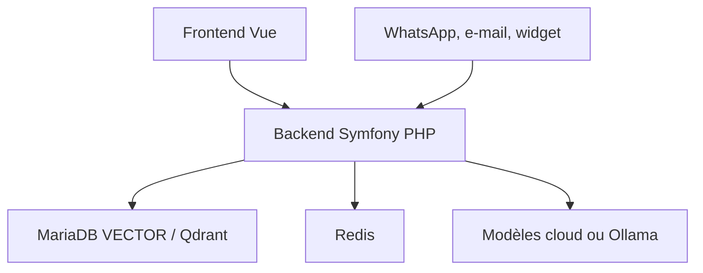

# metadist/synaplan

> Plateforme open source d'assistants IA sur tes documents, présents sur le web, WhatsApp, e-mail et Nextcloud.

## Le problème
Déployer le même assistant, avec les mêmes connaissances et règles, sur plusieurs canaux de travail demande beaucoup d'intégrations.

## Ce que ça fait vraiment
Interface web de chat et d'administration, recherche dans tes fichiers (MariaDB VECTOR ou Qdrant), choix du modèle par tâche (OpenAI, Anthropic, Mistral, Ollama local), coût affiché par réponse, validation humaine des actions. Widget de site, WhatsApp, e-mail, Outlook, serveur MCP et API compatible Anthropic.

## Comment c'est branché


## Essayer
```bash
git clone https://github.com/metadist/synaplan.git
cd synaplan
make up
```

## Coût et pièges
Docker Compose v2 et 8 Go de RAM ; premier démarrage de 5 à 15 minutes. Le compte de démo est `admin@synaplan.com` / `admin123` : à ne pas garder sur un serveur. Clés des modèles à ta charge ; l'offre hébergée est payante.

## Ce que ce n'est pas
Pas un simple chat : plusieurs conteneurs. Le README admet qu'Open WebUI ou LibreChat suffit pour une simple fenêtre de chat.

## Alternatives
- Open WebUI : plus simple pour un chat seul.
- LibreChat : chat multi-fournisseurs, démarrage plus rapide.
- Dify : plutôt un constructeur d'applications et de workflows.

## Pour toi
Surveiller : utile pour un assistant RAG multi-canaux auto-hébergé, mais lourd à monter pour un simple usage perso.

