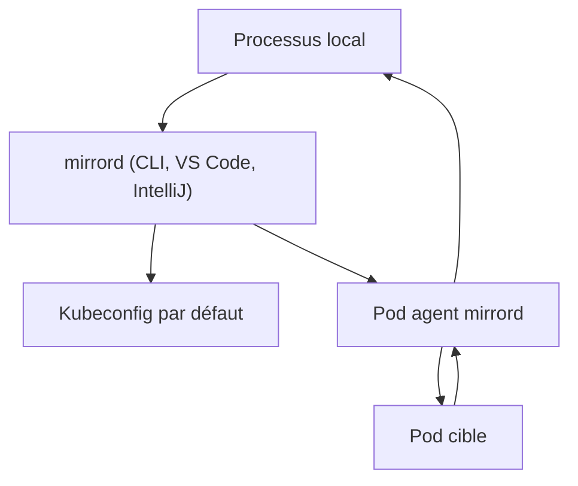

# metalbear-co/mirrord

> Runs a local process plugged into a Kubernetes pod, for developers and coding agents.

## The problem
Testing a service against real dependencies forces you to deploy to the cluster, which is slow and disrupts others.

## What it actually does
mirrord launches a pod on the same node as the target pod. Your local process receives the incoming traffic mirrored, sends its outgoing traffic through that pod, and reads the pod's files and environment variables. It exists as a VS Code extension, an IntelliJ plugin and a CLI. The Teams features (database branches, queue splitting, preview environments) are paid, with a seven-day trial.

## How it is wired
Simplified diagram based on the sheet, no diagram provided.


## Trying it
```bash
brew install metalbear-co/mirrord/mirrord
mirrord exec node app.js --target pod/my-pod
mirrord exec -f mirrord.json node app.js --target pod/my-pod
```

## Cost and gotchas
Access to a Kubernetes cluster is required. The agent requires the Linux capabilities `CAP_NET_ADMIN`, `CAP_SYS_PTRACE` and `CAP_SYS_ADMIN`, which can be reduced at the cost of lost features. The Teams features are paid.

## What it is not
Neither a deployment tool nor an isolated sandbox: your code acts on real services in the cluster. The README's raffle password has nothing technical about it.

## Alternatives
No alternative named in the README.

## For you
Adopt if you develop MLOps services on Kubernetes: fast feedback against the real cluster, with caution on shared writes.
