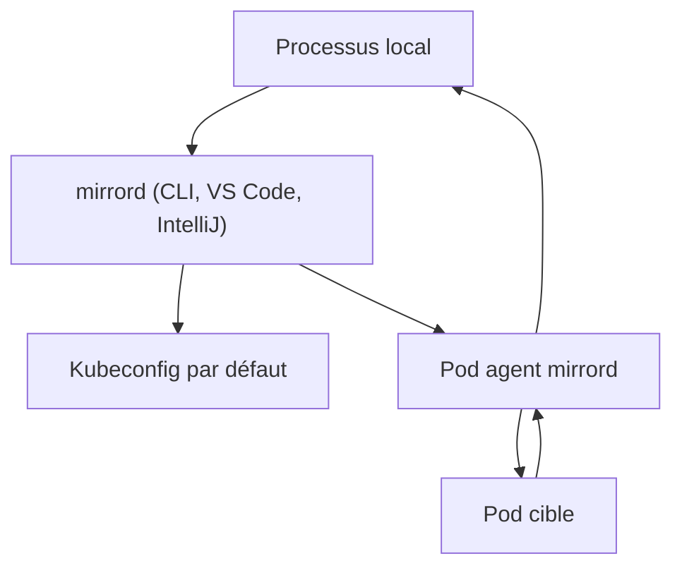

# metalbear-co/mirrord

> Exécute un processus local branché sur un pod Kubernetes, pour développeurs et agents de code.

## Le problème
Tester un service contre de vraies dépendances oblige à déployer sur le cluster, ce qui est lent et perturbe les autres.

## Ce que ça fait vraiment
mirrord lance un pod sur le même nœud que le pod ciblé. Ton processus local reçoit le trafic entrant en miroir, émet son trafic sortant par ce pod, et lit fichiers et variables d'environnement du pod. Il existe en extension VS Code, plugin IntelliJ et CLI. Les fonctions Teams (branches de base, découpe de files, environnements de prévisualisation) sont payantes, avec un essai de sept jours.

## Comment c'est branché
Schéma simplifié d'après la fiche, sans diagramme fourni.


## Essayer
```bash
brew install metalbear-co/mirrord/mirrord
mirrord exec node app.js --target pod/my-pod
mirrord exec -f mirrord.json node app.js --target pod/my-pod
```

## Coût et pièges
Accès à un cluster Kubernetes requis. L'agent demande les capacités Linux `CAP_NET_ADMIN`, `CAP_SYS_PTRACE` et `CAP_SYS_ADMIN`, réductibles au prix de fonctions perdues. Les fonctions Teams sont payantes.

## Ce que ce n'est pas
Ni un outil de déploiement ni un bac à sable isolé : ton code agit sur des services réels du cluster. Le mot de passe de tombola du README n'a rien de technique.

## Alternatives
Aucune alternative nommée dans le README.

## Pour toi
À adopter si tu développes des services MLOps sur Kubernetes : feedback rapide contre le vrai cluster, avec prudence sur les écritures partagées.

