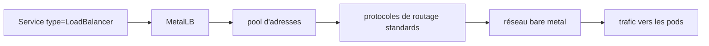

# metallb/metallb

> Load balancer implementation for bare-metal Kubernetes clusters, using standard routing protocols.

## The problem
On bare metal, a Service of type LoadBalancer stays pending indefinitely: no cloud provider comes along to assign it an IP.

## What it actually does
Provides a load balancer implementation for bare-metal Kubernetes clusters.
Relies on standard routing protocols rather than a cloud API.
The remaining features are not described in the README, which points to the project website.

## How it is wired

## Trying it
No installation command is documented in the README: it points to metallb.io and the stable branches.

## Cost and gotchas
Free. The README explicitly warns that the `main` branch is the development branch: consuming its manifests may lead to unstable or non-backward-compatible deployments. You need to pin to a stable branch.

## What it is not
Not an ingress controller: it assigns external IPs to Services, it does not route HTTP. Not a project documented in its repo: the README is just three sections, including a warning and a vulnerability disclosure procedure. Not usable on managed cloud, where the provider already does the job.

## Alternatives
No alternative named in the README.

## For you
A necessary building block if you expose services from an on-premise cluster, for example an inference server.
