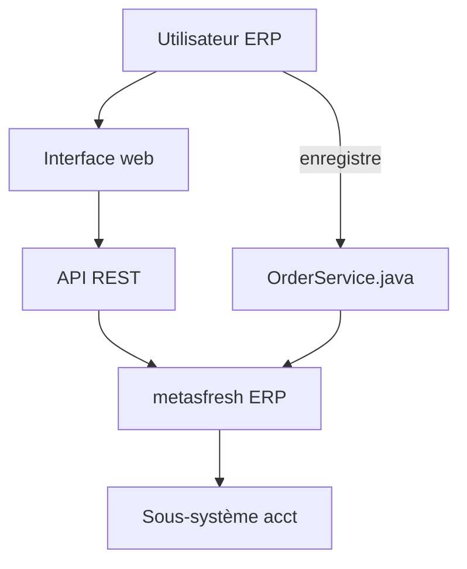

# metasfresh/metasfresh

> Free, reactive ERP for industrial and trading companies, with a REST API and web interface.

## The problem
Small and mid-sized industrial and trading companies need management software (orders, shipments, invoices) without a proprietary license.

## What it actually does
Three-tier ERP with a REST API and a web interface (HTML5, ReactJS, Redux). The documented flow: register a customer order, ship it, invoice it. The file tree also shows automatic order processing and an accounting subsystem (entries, journals, reports).

## How it is wired


## Trying it
```bash
git sparse-checkout init --clone
git sparse-checkout set frontend
git sparse-checkout disable
```
Installation via Docker or Ubuntu package, according to the README.

## Cost and gotchas
Free, but no license is declared in the catalog: clarify it before any use. A stable release is published every Friday. 2,987 open issues.

## What it is not
Not a data or AI tool. Not lightweight: a full ERP to install and configure.

## Alternatives
No alternative named in the README.

## For you
Ignore: an ERP with no declared license has no link with data / AI / MLOps work.
