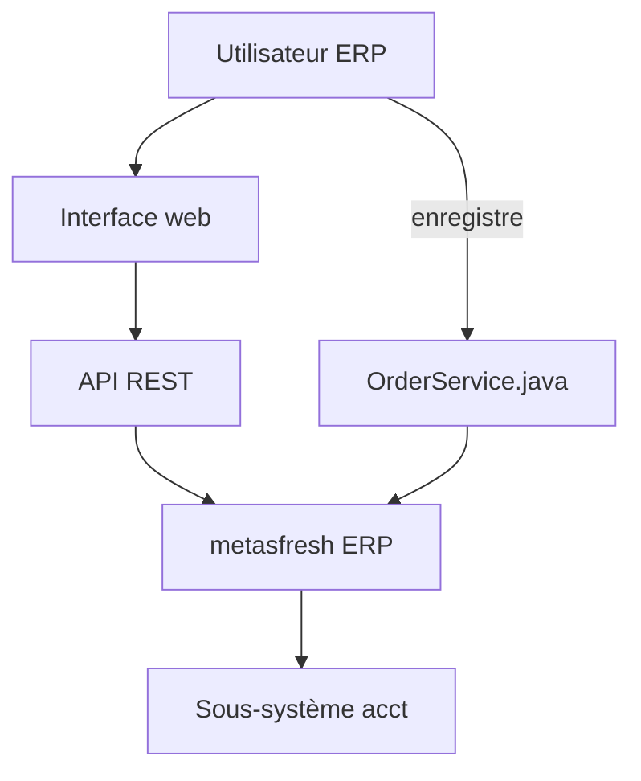

# metasfresh/metasfresh

> ERP libre et réactif pour entreprises de l'industrie et du commerce, avec API REST et interface web.

## Le problème
Les PME industrielles et commerciales ont besoin d'un logiciel de gestion (commandes, expéditions, factures) sans licence propriétaire.

## Ce que ça fait vraiment
ERP en trois niveaux avec API REST et interface web (HTML5, ReactJS, Redux). Le parcours documenté : enregistrer une commande client, l'expédier, la facturer. L'arborescence montre aussi un traitement automatique des commandes et un sous-système de comptabilité (écritures, journaux, rapports).

## Comment c'est branché


## Essayer
```bash
git sparse-checkout init --clone
git sparse-checkout set frontend
git sparse-checkout disable
```
Installation par Docker ou paquet Ubuntu, d'après le README.

## Coût et pièges
Gratuit, mais aucune licence déclarée dans le catalogue : à clarifier avant tout usage. Une version stable est publiée chaque vendredi. 2 987 issues ouvertes.

## Ce que ce n'est pas
Pas un outil data ou IA. Pas léger : un ERP complet à installer et paramétrer.

## Alternatives
Aucune alternative nommée dans le README.

## Pour toi
À ignorer : un ERP sans licence déclarée n'a pas de lien avec un travail data / IA / MLOps.

