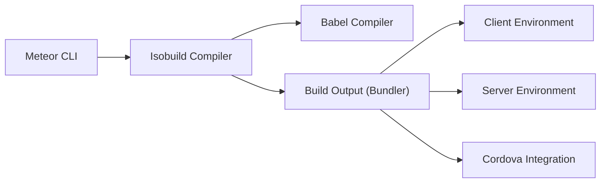

# meteor/meteor

> Full-stack JavaScript platform for building web and mobile applications with a single codebase, aimed at web developers.

## The problem
Assembling client, server, build, real-time and mobile requires configuring many disparate tools.

## What it actually does
Meteor provides a command-line tool that compiles and bundles an app (Isobuild compiler, Babel) for a client environment, a Node server and, via Cordova, mobile apps. A package system (Atmosphere, npm) extends it. It pairs with React, Blaze, Vue, Svelte or Solid. The README mentions "Meteor Agent Skills" for coding assistants.

## How it is wired


## Trying it
```bash
npx meteor
meteor create
cd my-app
meteor
```

## Cost and gotchas
Free; Galaxy, the hosting it mentions, is a separate service. The license is present but not identified by GitHub: check it before any commercial use.

## What it is not
Not a data or AI tool, and not a simple library: it imposes its build chain and conventions.

## Alternatives
- No alternative named in the README (React, Vue, Svelte, Solid appear there as UI layers, not as competitors).

## For you
Ignore: a full-stack web application framework does not serve a data/AI/MLOps workflow, and its unidentified license is one more flaw.
