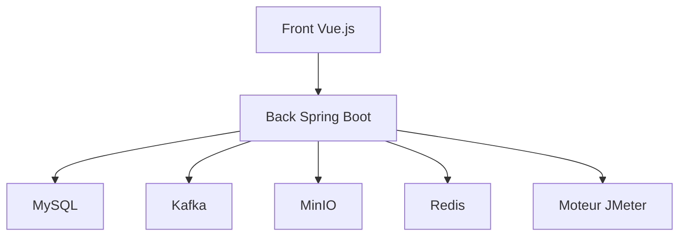

# metersphere/metersphere

> Open source continuous testing platform with an AI assistant, for test and QA teams.

## The problem
Test teams juggle test case management, API (Postman) and load (JMeter) tools, without unified collaboration.

## What it actually does
Test case management, execution plans, defects and reports; API testing (debugging, definition, mock, scenarios); an AI assistant generates functional and API cases; system-organization-project hierarchy; plugin system for DevOps integration. Stack: Spring Boot, Vue.js, MySQL, Kafka, MinIO, Redis, JMeter.

## How it is wired

Diagram inferred from the README's technical stack; no code diagram is provided.

## Trying it
No command in the README: it points to deployment via the 1Panel app store or an offline installation package (recommended in production).

## Cost and gotchas
Free in the community edition, with a paid enterprise edition (V3). Heavy stack (MySQL, Kafka, Redis, MinIO). Versions V1 and V2 are no longer maintained.

## What it is not
Not a tool for testing ML models. Documentation in Chinese. Not all enterprise edition features are in the community version.

## Alternatives
No alternative named in the README (it mentions other projects from the publisher, such as 1Panel or MaxKB, which are not substitutes).

## For you
Worth watching: useful if you equip an API QA team with AI generation, but the infrastructure footprint is heavy and the license remains to be checked.
