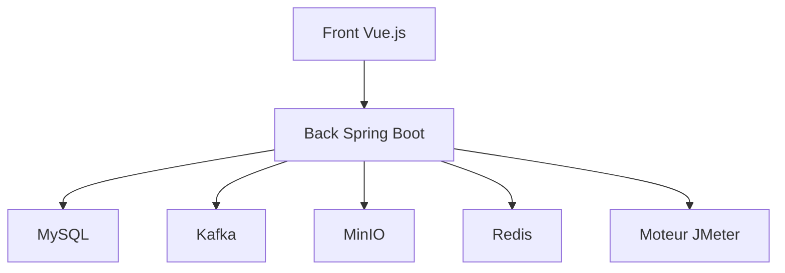

# metersphere/metersphere

> Plateforme open source de tests continus avec assistant IA, pour équipes de test et QA.

## Le problème
Les équipes de test jonglent entre outils de gestion de cas, d'API (Postman) et de charge (JMeter), sans collaboration unifiée.

## Ce que ça fait vraiment
Gestion des cas de test, plans d'exécution, défauts et rapports ; tests d'API (débogage, définition, mock, scénarios) ; un assistant IA génère cas fonctionnels et cas d'API ; hiérarchie système-organisation-projet ; système de plugins pour l'intégration DevOps. Pile : Spring Boot, Vue.js, MySQL, Kafka, MinIO, Redis, JMeter.

## Comment c'est branché

Diagramme déduit de la pile technique du README, aucun diagramme du code n'est fourni.

## Essayer
Aucune commande dans le README : il renvoie vers le déploiement via la boutique d'applications 1Panel ou un paquet d'installation hors ligne (recommandé en production).

## Coût et pièges
Gratuit en édition communauté, avec une édition entreprise payante (V3). Pile lourde (MySQL, Kafka, Redis, MinIO). Les versions V1 et V2 ne sont plus maintenues.

## Ce que ce n'est pas
Pas un outil de test de modèles ML. Documentation en chinois. Les fonctions de l'édition entreprise ne sont pas toutes dans la version communautaire.

## Alternatives
Aucune alternative nommée dans le README (il cite d'autres projets de l'éditeur, comme 1Panel ou MaxKB, qui ne sont pas des substituts).

## Pour toi
À surveiller : utile si tu outilles une équipe QA d'API avec génération par IA, mais l'empreinte d'infrastructure est lourde et la licence reste à vérifier.

