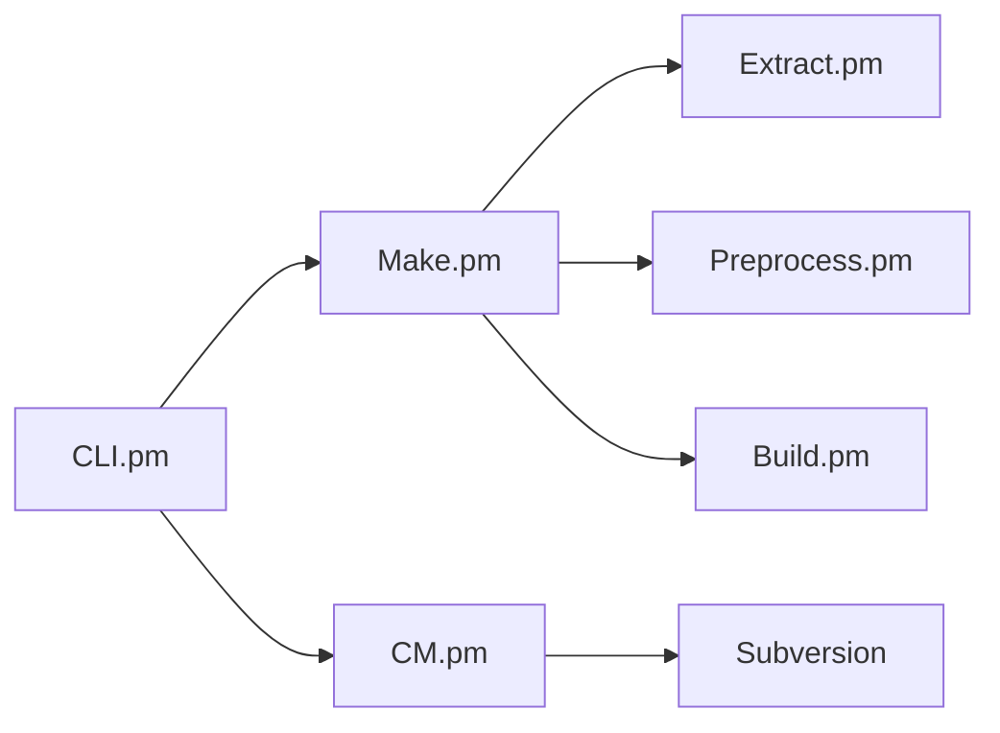

# metomi/fcm

> Fortran build system and Subversion wrapper for developing scientific software.

## The problem
Building large scientific Fortran codes and managing their Subversion branches with consistent commands.

## What it actually does
Two families of Perl commands: the build (configuration, source extraction, preprocessing, compilation tasks) and Subversion commands (branches, conflicts), plus repository administration and hook tools, including a permissions check (`svnperms.py`). The execution links are not confirmed by the excerpts.

## How it is wired

## Trying it
No commands in the README: it points to the installation guide and the user guide.

## Cost and gotchas
GPL-3.0. Depends on Subversion; the README is dated (copyright 2006-2021).

## What it is not
Not a Git tool: the workflow is Subversion.

## Alternatives
No alternative named in the README.

## For you
Ignore: only useful if you maintain modelling Fortran under Subversion, outside data/AI/MLOps.
