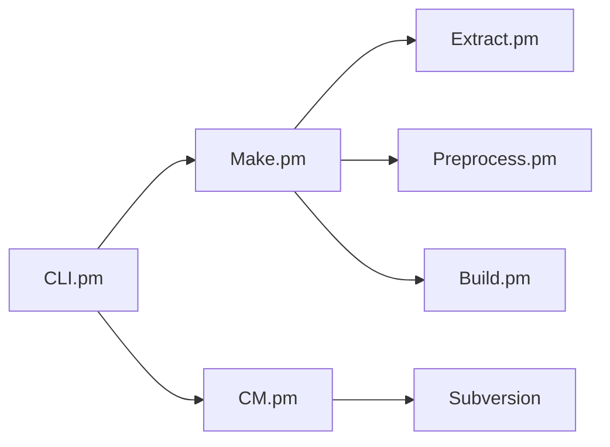

# metomi/fcm

> Système de build Fortran et surcouche à Subversion pour le développement de logiciels scientifiques.

## Le problème
Compiler de gros codes Fortran scientifiques et gérer leurs branches Subversion avec des commandes homogènes.

## Ce que ça fait vraiment
Deux familles de commandes en Perl : le build (configuration, extraction des sources, préprocessing, tâches de compilation) et des commandes Subversion (branches, conflits), plus des outils d'administration de dépôt et de hooks, dont un contrôle de permissions (`svnperms.py`). Les liens d'exécution ne sont pas confirmés par les extraits.

## Comment c'est branché

## Essayer
Aucune commande dans le README : renvoi au guide d'installation et au guide utilisateur.

## Coût et pièges
GPL-3.0. Dépend de Subversion ; README daté (copyright 2006-2021).

## Ce que ce n'est pas
Pas un outil Git : le flux de travail est Subversion.

## Alternatives
Aucune alternative nommée dans le README.

## Pour toi
À ignorer : utile seulement si tu maintiens du Fortran de modélisation sous Subversion, hors data/IA/MLOps.

